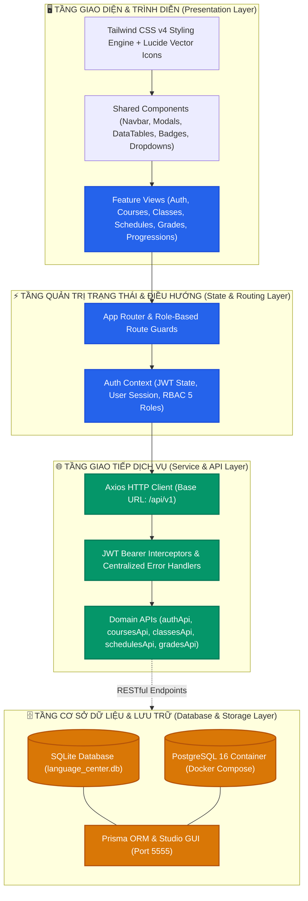

# 🎓 SMART-EDU LMS — Hệ Thống Quản Lý Trung Tâm Ngoại Ngữ

<p align="center">
  
  
  
  
  
  
</p>

---

## 📖 1. TỔNG QUAN DỰ ÁN

**SMART-EDU LMS** là giải pháp phần mềm toàn diện hỗ trợ số hóa và tự động hóa quy trình quản lý, đào tạo và vận hành tại các Trung tâm Ngoại ngữ. Dự án tập trung giải quyết các bài toán nghiệp vụ trọng yếu: tuyển sinh trực tuyến, điều phối lớp học, kiểm soát sĩ số, lập lịch thời khóa biểu tự động phát hiện xung đột, quản lý sổ điểm trọng số và theo dõi lộ trình đào tạo của học viên.

Phiên bản **VER2** được tái cấu trúc theo mô hình **Decoupled Architecture (Tách rời Frontend & Database)** nhằm tối ưu hóa tính độc lập, khả năng mở rộng và hiệu năng hệ thống:
- **Frontend SPA Hiện Đại:** Xây dựng trên nền tảng **React 19**, **Vite 8** và **Tailwind CSS v4** theo mô hình *Feature-Driven Architecture*, tối ưu re-render, giao diện phản hồi nhanh và thân thiện trên mọi thiết bị.
- **Tầng Database Độc Lập:** Tách biệt cơ sở dữ liệu quan hệ với đầy đủ lược đồ chuẩn hóa 3NF, hỗ trợ song song **SQLite** (phát triển nhanh không cần cấu hình) và **PostgreSQL 16** (container hóa với Docker Compose sẵn sàng cho môi trường production).
- **Sẵn Sàng Tích Hợp API:** Lớp dịch vụ API (`api.js`) với cơ chế Axios Interceptors xử lý JWT Bearer Token tập trung, chuẩn hóa request/response và dễ dàng kết nối tới bất kỳ nền tảng Backend nào (FastAPI, Express, Spring Boot, NestJS...).

---

## 🏛️ 2. KIẾN TRÚC HỆ THỐNG & NGUYÊN LÝ THIẾT KẾ

Hệ thống được thiết kế theo kiến trúc phân tầng (Layered Architecture) với nguyên lý phân tách trách nhiệm (Separation of Concerns - SoC) và khớp nối lỏng (Loose Coupling):



### Các nguyên lý kiến trúc cốt lõi:
1. **Feature-Driven Frontend Organization:** Mỗi phân hệ nghiệp vụ (Khóa học, Lớp học, Thời khóa biểu, Điểm số, Đăng ký) được đóng gói độc lập theo từng màn hình chuyên biệt (`src/views/`), giúp dễ bảo trì, mở rộng hoặc viết lại mà không ảnh hưởng tới toàn cục.
2. **Role-Based Access Control (RBAC):** Kiểm soát phân quyền tập trung tại `AuthContext`, tự động lọc quyền truy cập màn hình và chức năng theo 5 vai trò hệ thống (`ADMIN`, `ACADEMIC_STAFF`, `TEACHER`, `STUDENT`, `PARENT`).
3. **Decoupled Data Source:** Tách hoàn toàn tầng dữ liệu ra khỏi mã nguồn ứng dụng web. Dữ liệu có thể được truy vấn trực tiếp qua công cụ GUI, Prisma Studio hoặc tích hợp qua các REST/GraphQL API gateway.

---

## 🚀 3. HƯỚNG DẪN KHỞI CHẠY (QUICK START)

### Yêu cầu môi trường:
- **Node.js**: Phiên bản `18.x` trở lên (Khuyên dùng `20+` LTS).
- **Trình duyệt hiện đại**: Chrome, Edge, Firefox, Brave.
- *(Tùy chọn)* **Docker & Docker Desktop**: Nếu muốn chạy PostgreSQL 16.

---

### Bước 1: Khởi động Ứng dụng Web Frontend (React 19)

1. Cài đặt các thư viện phụ thuộc:
   ```bash
   cd frontend
   npm install
   ```
2. Khởi chạy máy chủ phát triển (Development Server):
   ```bash
   npm run dev
   ```
   Hoặc trên Windows chỉ cần nhấp đúp vào tệp: **[`start_frontend.bat`](file:///d:/Smart-edu/start_frontend.bat)**.

3. Mở trình duyệt và truy cập:
   👉 **`http://localhost:5173`**

---

### Bước 2: Tùy chọn Cơ sở dữ liệu (Database Layer)

Hệ thống cung cấp sẵn hai tùy chọn cơ sở dữ liệu linh hoạt:

#### 🔹 Tùy chọn A: Sử dụng SQLite (Zero-config, không cần cài đặt)
File cơ sở dữ liệu SQLite đã được tạo sẵn tại [`database/language_center.db`](file:///d:/Smart-edu/database/language_center.db) chứa đầy đủ 12 bảng và dữ liệu khởi tạo.
- Xem trực tiếp bằng DBeaver, TablePlus hoặc SQLite Viewer.
- Hoặc mở giao diện trực quan **Prisma Studio**:
  ```bash
  npm run prisma:sqlite:studio
  ```
  Truy cập: `http://localhost:5555`

#### 🔹 Tùy chọn B: Sử dụng PostgreSQL 16 qua Docker
Tệp [`docker-compose.yml`](file:///d:/Smart-edu/docker-compose.yml) đã được cấu hình tự động ánh xạ script [`database/init_postgres.sql`](file:///d:/Smart-edu/database/init_postgres.sql) khi container khởi động:
```bash
docker compose up -d
```
- **Host:** `localhost:5432`
- **Database:** `language_center`
- **User:** `postgres`
- **Password:** `postgrespassword2026`

---

## 📂 4. CẤU TRÚC DỰ ÁN (PROJECT STRUCTURE)

```text
SMART-EDU-VER2/
├── .agents/                    # Bộ quy chuẩn Agent Skills & Workflow hướng đối tượng
├── database/                   # Module Cơ sở dữ liệu độc lập
│   ├── language_center.db      # Cơ sở dữ liệu SQLite binary nguyên bản (12 bảng + seed data)
│   ├── language_center_dump.sql# Bản xuất DDL & DML hoàn chỉnh theo chuẩn SQLite
│   ├── init_postgres.sql       # Script khởi tạo tự động tương thích PostgreSQL 16+
│   └── README.md               # Tài liệu hướng dẫn chi tiết kiến trúc Database
├── docs/                       # Tài liệu thiết kế hệ thống chuyên sâu
│   ├── DATABASE_DESIGN.md      # Chi tiết lược đồ ERD, quan hệ khóa ngoại và kiểu dữ liệu
│   ├── SYSTEM_DESIGN.md        # Thiết kế kiến trúc tổng thể, luồng nghiệp vụ và bảo mật
│   ├── ISSUES.md               # Đặc tả 11 Core Business Issues & Acceptance Criteria
│   └── DESIGN.md               # Nguyên lý thiết kế hướng đối tượng OOAD & DDD-Lite
├── frontend/                   # Ứng dụng Web Single Page Application (React 19 + Vite)
│   ├── public/                 # Favicons, assets tĩnh và icons SVG
│   ├── src/
│   │   ├── assets/             # Hình ảnh và đồ họa giao diện
│   │   ├── components/         # Các UI component dùng chung (Navbar, Modal, Tables, Badges)
│   │   ├── context/            # AuthContext quản lý trạng thái phiên làm việc & JWT
│   │   ├── services/           # api.js tập trung gọi API qua Axios
│   │   ├── views/              # Các màn hình phân hệ chức năng tương ứng
│   │   ├── App.jsx             # Điều hướng router và bố cục ứng dụng
│   │   └── main.jsx            # Entry point của React 19
│   ├── package.json            # Cấu hình dependencies Frontend (React 19, Tailwind v4)
│   └── vite.config.js          # Cấu hình Vite build tool
├── prisma/                     # Lược đồ Prisma ORM
│   ├── schema.prisma           # Cấu hình cho PostgreSQL
│   ├── schema.sqlite.prisma    # Cấu hình cho SQLite cục bộ
│   └── seed.js                 # Script nạp dữ liệu mẫu đa nền tảng
├── docker-compose.yml          # Dịch vụ PostgreSQL 16 container tự động nạp init.sql
├── package.json                # Quản lý scripts Prisma toàn cục cho dự án
├── start_frontend.bat          # Script 1-click khởi chạy nhanh Frontend trên Windows
└── README.md                   # Tài liệu hướng dẫn sử dụng chính của dự án
```

---

## 🛠️ 5. CÔNG NGHỆ SỬ DỤNG (TECH STACK)

| Thành phần | Công nghệ | Phiên bản | Mô tả vai trò |
|---|---|:---:|---|
| **Core UI Library** | React | `19.3.1` | Thư viện UI hiện đại, tối ưu hóa re-render và state management. |
| **Build Tool** | Vite | `8.3.4` | Trình biên dịch siêu tốc với cơ chế Hot Module Replacement (HMR). |
| **Styling** | Tailwind CSS | `v4.3` | Tiện ích CSS thế hệ mới, giao diện tinh tế, hỗ trợ Dark/Light responsive. |
| **Icons** | Lucide React | `1.60.0` | Bộ biểu tượng vector nhất quán, sắc nét theo chuẩn chuyên nghiệp. |
| **HTTP Client** | Axios | `1.20.0` | Kết nối API, xử lý JWT Bearer token và xử lý lỗi tập trung qua Interceptors. |
| **Database** | PostgreSQL / SQLite | `16` / `3` | Lưu trữ dữ liệu quan hệ, đảm bảo tính toàn vẹn và ràng buộc nghiệp vụ. |
| **ORM Tool** | Prisma | `6.4.1` | Quản trị schema, database migration và trực quan hóa dữ liệu qua Prisma Studio. |

---

## 📄 6. BẢN QUYỀN & THÔNG TIN

Dự án được xây dựng phục vụ nghiên cứu, học tập và triển khai thực tế hệ thống Quản lý Đào tạo Ngoại ngữ.

- **Repository Chính:** [tenki1612/SMART-EDU-VER2](https://github.com/tenki1612/SMART-EDU-VER2)
- **Tác giả:** [tenki1612](https://github.com/tenki1612)
- **Giấy phép:** [MIT License](https://opensource.org/licenses/MIT)
