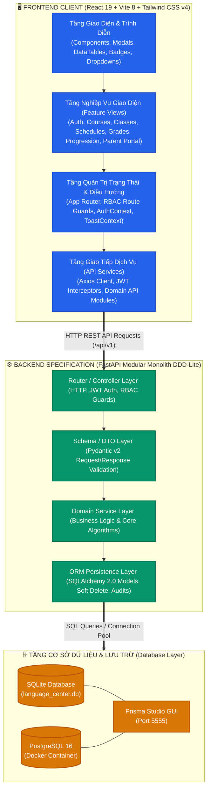

# 🎓 SMART-EDU LMS — Hệ Thống Quản Lý Trung Tâm Ngoại Ngữ

---

## 📖 1. TỔNG QUAN DỰ ÁN

**SMART-EDU LMS** là giải pháp phần mềm toàn diện hỗ trợ số hóa và tự động hóa quy trình quản lý, đào tạo và vận hành tại các Trung tâm Ngoại ngữ. Dự án tập trung giải quyết các bài toán nghiệp vụ trọng yếu: tuyển sinh trực tuyến, điều phối lớp học, kiểm soát sĩ số, lập lịch thời khóa biểu tự động phát hiện xung đột, quản lý sổ điểm trọng số và theo dõi lộ trình đào tạo của học viên.

Phiên bản **VER2** được tái cấu trúc theo mô hình **Decoupled Architecture (Tách rời Frontend & Database)** nhằm tối ưu hóa tính độc lập, khả năng mở rộng và hiệu năng hệ thống:
- **Frontend SPA Hiện Đại:** Xây dựng trên nền tảng **React 19**, **Vite 8** và **Tailwind CSS v4** theo mô hình *Feature-Driven Architecture*, tối ưu re-render, giao diện phản hồi nhanh và thân thiện trên mọi thiết bị.
- **Tầng Database Độc Lập:** Tách biệt cơ sở dữ liệu quan hệ với đầy đủ lược đồ chuẩn hóa 3NF, hỗ trợ song song **SQLite** (phát triển nhanh không cần cấu hình) và **PostgreSQL 16** (container hóa với Docker Compose sẵn sàng cho môi trường production).
- **Sẵn Sàng Tích Hợp API:** Lớp dịch vụ API (`api.js`) với cơ chế Axios Interceptors xử lý JWT Bearer Token tập trung, chuẩn hóa request/response và dễ dàng kết nối tới bất kỳ nền tảng Backend nào (FastAPI, Express, Spring Boot, NestJS...).

---

## 🏛️ 2. KIẾN TRÚC HỆ THỐNG

### 2.1. Kiến Trúc Tổng Thể (System Architecture)

Hệ thống được tổ chức theo mô hình phân tầng chuẩn mực, phân tách độc lập giữa **Frontend SPA**, **Lớp Giao tiếp Dịch vụ (API Service Layer)** và **Tầng Cơ sở Dữ liệu & Lưu trữ**:



---

### 2.2. Chi Tiết Kiến Trúc Frontend (React 19 / Feature-Driven Architecture)

Frontend được cấu trúc theo triết lý **Feature-Driven Architecture** kết hợp tiêu chuẩn thiết kế **Operate Mode** (tối ưu năng suất cho người vận hành nhập liệu liên tục):

1. **Tầng Giao diện & Trình diễn (Presentation Layer):**
   - **Thư viện nền tảng:** React 19.3+, Vite 8 (Hot Module Replacement siêu tốc), Tailwind CSS v4.
   - **Tổ chức theo tính năng (`src/views/`):** Mỗi phân hệ là một View độc lập (`CoursesView`, `ClassesView`, `SchedulesView`, `GradesView`, `ProgressionParentView`...), không phụ thuộc chéo, dễ bảo trì và mở rộng.
   - **Hệ thống Component dùng chung (`src/components/`):** Các khối giao diện tiêu chuẩn gồm Header Navbar, Sidebar phân nhóm theo vai trò, Modal xác nhận, Data Table hỗ trợ phân trang và tìm kiếm nhanh.
   - **Chuẩn hiển thị số liệu & Trạng thái:** Sử dụng phông chữ `JetBrains Mono` kết hợp `tabular-nums` cho các cột điểm số, học phí và sĩ số; sử dụng thẻ trạng thái ngữ nghĩa (Semantic Badges) với chấm màu tín hiệu giúp quét thông tin nhanh (Scanability).

2. **Tầng Quản lý Trạng thái & Phân quyền (State & Routing Layer):**
   - **`AuthContext.jsx`:** Quản lý tập trung trạng thái đăng nhập, giải mã JWT Bearer token, tự động khôi phục phiên từ `localStorage` và cung cấp quyền hạn cho toàn bộ cây component.
   - **Kiểm soát truy cập theo vai trò (RBAC Route Guard):** Tự động điều hướng và chỉ hiển thị các màn hình mà người dùng hiện tại có quyền thao tác (Admin, Staff, Teacher, Student, Parent).
   - **`ToastContext.jsx`:** Cơ chế thông báo nổi (non-blocking notification) tự động ẩn sau 4 giây, loại bỏ hoàn toàn các hộp thoại `alert()` gây gián đoạn luồng làm việc.

3. **Tầng Kết nối Dịch vụ (Service & API Client Layer):**
   - **Axios Client tập trung (`src/services/api.js`):** Khởi tạo instance kết nối thống nhất với tiền tố `/api/v1`.
   - **Request Interceptor:** Tự động đính kèm `Authorization: Bearer <token>` vào mọi yêu cầu gửi đi.
   - **Response Interceptor:** Bắt lỗi tập trung (xử lý lỗi `401 Unauthorized` tự động xóa token và chuyển về trang đăng nhập; trích xuất chi tiết thông báo lỗi từ server để hiển thị Toast).

---

### 2.3. Chi Tiết Kiến Trúc Backend (Modular Monolith & DDD-Lite)

Backend của hệ thống được quy hoạch và thiết kế theo kiến trúc **Modular Monolith & DDD-Lite** (Domain-Driven Design rút gọn), phân chia thành 11 Bounded Contexts độc lập và tự bao hàm:

1. **Cấu trúc 4 lớp phân lập nghiêm ngặt trong mỗi Bounded Context:**
   - **`router.py` (Lớp Giao vận / Controller):** Khai báo các HTTP endpoints chuẩn RESTful, nhận diện phiên người dùng qua JWT và thực thi phân quyền RBAC qua Dependency Injection (`require_roles`).
   - **`schemas.py` (Lớp Hợp đồng Dữ liệu / DTO):** Sử dụng **Pydantic v2** làm "Nguồn chân lý duy nhất" (Single Source of Truth) để validate dữ liệu đầu vào (Create/Update DTO) và tuần tự hóa dữ liệu phản hồi (Response DTO).
   - **`service.py` (Lớp Nghiệp vụ / Domain Service):** Chứa toàn bộ logic xử lý nghiệp vụ, tính toán công thức, kiểm tra ràng buộc điều kiện và quản lý giao dịch (DB Transactions).
   - **`models.py` (Lớp Thực thể / Persistence Layer):** Định nghĩa bảng cơ sở dữ liệu qua **SQLAlchemy 2.0**, kế thừa `TimestampMixin` (tự động lưu `created_at`, `updated_at`) và hỗ trợ xóa an toàn (Soft Delete qua cờ `is_deleted`).

2. **Ba Thuật toán Nghiệp vụ Cốt lõi của Backend:**
   - **Thuật toán Phát hiện Xung đột Lịch học Thời gian thực (`conflict_checker`):**
     Hai ca học bị coi là va chạm khi và chỉ khi thỏa mãn điều kiện thời gian:
     $$\text{Conflict} \iff (\text{start}_A < \text{end}_B) \land (\text{end}_A > \text{start}_B)$$
     Thuật toán quét đồng thời trên cả 2 tài nguyên: **Phòng học (`classroom_id`)** và **Giảng viên (`teacher_id`)** trên cùng một ngày học (`session_date`), ngăn chặn tuyệt đối tình trạng xếp trùng phòng hoặc giáo viên dạy cùng lúc 2 lớp.
   - **Thuật toán Tính điểm Trọng số & Khóa Sổ điểm (`grades_calculator`):**
     Điểm tổng kết môn học được tính tự động theo công thức trọng số chuẩn:
     $$\text{Điểm tổng kết} = 0.2 \times \text{Chuyên cần} + 0.3 \times \text{Giữa kỳ} + 0.5 \times \text{Cuối kỳ}$$
     - Học viên được xếp loại **ĐẠT (PASSED)** khi: $\text{Điểm tổng kết} \ge 5.0$ **VÀ** $\text{Điểm cuối kỳ} \ge 4.0$.
     - Cơ chế Khóa sổ điểm (`is_confirmed = True`) do Học vụ thực hiện: khi đã khóa, hệ thống khóa toàn bộ quyền sửa điểm của giảng viên để đảm bảo tính toàn vẹn dữ liệu đào tạo.
   - **Thuật toán Kiểm soát Điều kiện Tiên quyết Chuyển khóa (`progression_checker`):**
     Học viên chỉ được phép đăng ký lên khóa học kế tiếp khi khóa học trước đó đã có kết quả **ĐẠT (PASSED)** và đã được học vụ khóa sổ điểm chính thức.

3. **Bảo mật & Cấp quyền Hệ thống (Security & Authentication):**
   - Mật khẩu người dùng được băm một chiều an toàn bằng thuật toán **Bcrypt** (Salt rounds = 12).
   - Xác thực phiên làm việc thông qua **JSON Web Token (JWT)** chuẩn thuật toán `HS256`, thời hạn hiệu lực 24 giờ.
   - Cơ chế bảo vệ tài khoản tự động: Khóa tạm thời 15 phút nếu phát hiện nhập sai mật khẩu quá 5 lần liên tiếp.

---

### 2.4. Kiến Trúc Dữ Liệu & Lưu Trữ (Database Architecture)

Hệ thống triển khai mô hình cơ sở dữ liệu quan hệ chuẩn 3NF với 12 bảng thực thể chính:
- **Hỗ trợ Đa nền tảng Cơ sở dữ liệu:**
  - **SQLite (`language_center.db`):** Zero-config, tích hợp sẵn toàn bộ dữ liệu mẫu, phù hợp chạy kiểm thử cục bộ hoặc chạy demo ngay lập tức.
  - **PostgreSQL 16:** Được cấu hình sẵn qua Docker Compose kèm script tự động nạp bảng và sequences (`init_postgres.sql`), sẵn sàng triển khai môi trường máy chủ production.
- **Quản trị Lược đồ & Dữ liệu trực quan:** Tích hợp bộ công cụ **Prisma ORM** (`schema.prisma` và `schema.sqlite.prisma`) cho phép quản lý schema migration và tra cứu dữ liệu qua giao diện web **Prisma Studio** trên cổng `5555`.

---

## 🚀 3. HƯỚNG DẪN KHỞI CHẠY (QUICK START)

### Yêu cầu môi trường:
- **Node.js**: Phiên bản `18.x` trở lên (Khuyên dùng `20+` LTS).
- **Trình duyệt hiện đại**: Chrome, Edge, Firefox, Brave.
- *(Tùy chọn)* **Docker & Docker Desktop**: Nếu muốn chạy PostgreSQL 16.

---

### Bước 1: Khởi động Ứng dụng Web Frontend (React 19)

1. Cài đặt các thư viện phụ thuộc:
   ```bash
   cd frontend
   npm install
   ```
2. Khởi chạy máy chủ phát triển (Development Server):
   ```bash
   npm run dev
   ```
   Hoặc trên Windows chỉ cần nhấp đúp vào tệp: **[`start_frontend.bat`](file:///d:/Smart-edu/start_frontend.bat)**.

3. Mở trình duyệt và truy cập:
   👉 **`http://localhost:5173`**

---

### Bước 2: Tùy chọn Cơ sở dữ liệu (Database Layer)

Hệ thống cung cấp sẵn hai tùy chọn cơ sở dữ liệu linh hoạt:

#### 🔹 Tùy chọn A: Sử dụng SQLite (Zero-config, không cần cài đặt)
File cơ sở dữ liệu SQLite đã được tạo sẵn tại [`database/language_center.db`](file:///d:/Smart-edu/database/language_center.db) chứa đầy đủ 12 bảng và dữ liệu khởi tạo.
- Xem trực tiếp bằng DBeaver, TablePlus hoặc SQLite Viewer.
- Hoặc mở giao diện trực quan **Prisma Studio**:
  ```bash
  npm run prisma:sqlite:studio
  ```
  Truy cập: `http://localhost:5555`

#### 🔹 Tùy chọn B: Sử dụng PostgreSQL 16 qua Docker
Tệp [`docker-compose.yml`](file:///d:/Smart-edu/docker-compose.yml) đã được cấu hình tự động ánh xạ script [`database/init_postgres.sql`](file:///d:/Smart-edu/database/init_postgres.sql) khi container khởi động:
```bash
docker compose up -d
```
- **Host:** `localhost:5432`
- **Database:** `language_center`
- **User:** `postgres`
- **Password:** `postgrespassword2026`

---

## 📂 4. CẤU TRÚC DỰ ÁN (PROJECT STRUCTURE)

```text
SMART-EDU-VER2/
├── .agents/                    # Bộ quy chuẩn Agent Skills & Workflow hướng đối tượng
├── database/                   # Module Cơ sở dữ liệu độc lập
│   ├── language_center.db      # Cơ sở dữ liệu SQLite binary nguyên bản (12 bảng + seed data)
│   ├── language_center_dump.sql# Bản xuất DDL & DML hoàn chỉnh theo chuẩn SQLite
│   ├── init_postgres.sql       # Script khởi tạo tự động tương thích PostgreSQL 16+
│   └── README.md               # Tài liệu hướng dẫn chi tiết kiến trúc Database
├── docs/                       # Tài liệu thiết kế hệ thống chuyên sâu
│   ├── DATABASE_DESIGN.md      # Chi tiết lược đồ ERD, quan hệ khóa ngoại và kiểu dữ liệu
│   ├── SYSTEM_DESIGN.md        # Thiết kế kiến trúc tổng thể, luồng nghiệp vụ và bảo mật
│   ├── ISSUES.md               # Đặc tả 11 Core Business Issues & Acceptance Criteria
│   └── DESIGN.md               # Nguyên lý thiết kế hướng đối tượng OOAD & DDD-Lite
├── frontend/                   # Ứng dụng Web Single Page Application (React 19 + Vite)
│   ├── public/                 # Favicons, assets tĩnh và icons SVG
│   ├── src/
│   │   ├── assets/             # Hình ảnh và đồ họa giao diện
│   │   ├── components/         # Các UI component dùng chung (Navbar, Modal, Tables, Badges)
│   │   ├── context/            # AuthContext quản lý trạng thái phiên làm việc & JWT
│   │   ├── services/           # api.js tập trung gọi API qua Axios
│   │   ├── views/              # Các màn hình phân hệ chức năng tương ứng
│   │   ├── App.jsx             # Điều hướng router và bố cục ứng dụng
│   │   └── main.jsx            # Entry point của React 19
│   ├── package.json            # Cấu hình dependencies Frontend (React 19, Tailwind v4)
│   └── vite.config.js          # Cấu hình Vite build tool
├── prisma/                     # Lược đồ Prisma ORM
│   ├── schema.prisma           # Cấu hình cho PostgreSQL
│   ├── schema.sqlite.prisma    # Cấu hình cho SQLite cục bộ
│   └── seed.js                 # Script nạp dữ liệu mẫu đa nền tảng
├── docker-compose.yml          # Dịch vụ PostgreSQL 16 container tự động nạp init.sql
├── package.json                # Quản lý scripts Prisma toàn cục cho dự án
├── start_frontend.bat          # Script 1-click khởi chạy nhanh Frontend trên Windows
└── README.md                   # Tài liệu hướng dẫn sử dụng chính của dự án
```

---

## 🛠️ 5. CÔNG NGHỆ SỬ DỤNG (TECH STACK)

| Thành phần | Công nghệ | Phiên bản | Mô tả vai trò |
|---|---|:---:|---|
| **Core UI Library** | React | `19.3.1` | Thư viện UI hiện đại, tối ưu hóa re-render và state management. |
| **Build Tool** | Vite | `8.3.4` | Trình biên dịch siêu tốc với cơ chế Hot Module Replacement (HMR). |
| **Styling** | Tailwind CSS | `v4.3` | Tiện ích CSS thế hệ mới, giao diện tinh tế, hỗ trợ Dark/Light responsive. |
| **Icons** | Lucide React | `1.60.0` | Bộ biểu tượng vector nhất quán, sắc nét theo chuẩn chuyên nghiệp. |
| **HTTP Client** | Axios | `1.20.0` | Kết nối API, xử lý JWT Bearer token và xử lý lỗi tập trung qua Interceptors. |
| **Database** | PostgreSQL / SQLite | `16` / `3` | Lưu trữ dữ liệu quan hệ, đảm bảo tính toàn vẹn và ràng buộc nghiệp vụ. |
| **ORM Tool** | Prisma | `6.4.1` | Quản trị schema, database migration và trực quan hóa dữ liệu qua Prisma Studio. |

---

## 📄 6. BẢN QUYỀN & THÔNG TIN

Dự án được xây dựng phục vụ nghiên cứu, học tập và triển khai thực tế hệ thống Quản lý Đào tạo Ngoại ngữ.

- **Repository Chính:** [tenki1612/SMART-EDU-VER2](https://github.com/tenki1612/SMART-EDU-VER2)
- **Tác giả:** [tenki1612](https://github.com/tenki1612)
- **Giấy phép:** [MIT License](https://opensource.org/licenses/MIT)
