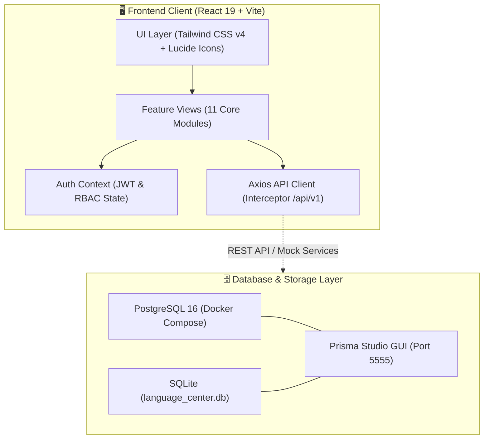

# 🎓 SMART-EDU LMS — Hệ Thống Quản Lý Trung Tâm Ngoại Ngữ

<p align="center">
  
  
  
  
  
  
</p>

---

## 📖 1. TỔNG QUAN DỰ ÁN

**SMART-EDU LMS** là nền tảng quản trị và vận hành toàn diện dành cho Trung tâm Ngoại ngữ hiện đại. Hệ thống được xây dựng theo kiến trúc **Feature-Driven Frontend (React 19 + Vite + Tailwind CSS v4)** kết hợp module **Cơ sở dữ liệu độc lập (PostgreSQL 16 & SQLite)**, hiện thực hóa đầy đủ **82 chức năng nghiệp vụ (FR-01 $\rightarrow$ FR-82)** thuộc **11 phân hệ nghiệp vụ** và đáp ứng 5 nhóm vai trò người dùng trong hệ sinh thái giáo dục.

### 🌟 Điểm nổi bật:
- ⚡ **Giao diện thế hệ mới:** Tận dụng hiệu năng vượt trội của **React 19**, **Vite 8** và **Tailwind CSS v4** với trải nghiệm người dùng phản hồi tức thì (Instant UI feedback).
- 🛡️ **Phân quyền vai trò nghiêm ngặt (RBAC 5 Roles):** Quản trị viên (Admin), Nhân viên học vụ (Staff), Giáo viên (Teacher), Học viên (Student), Phụ huynh (Parent).
- 🧩 **11 Phân hệ chức năng hoàn chỉnh:** Từ tuyển sinh, xếp lớp, quản lý thời khóa biểu ma trận tuần, phát hiện xung đột lịch học, đến sổ điểm trọng số và lộ trình nâng khóa.
- 🗄️ **Database đa năng & sẵn sàng sử dụng:** Cung cấp sẵn cơ sở dữ liệu SQLite (zero-config) và PostgreSQL 16 tích hợp Docker Compose tự động nạp dữ liệu khởi tạo.

---

## 🏛️ 2. KIẾN TRÚC HỆ THỐNG



---

## 👥 3. TÀI KHOẢN MẪU KHỞI TẠO (5 VAI TRÒ SẴN CÓ)

Cơ sở dữ liệu đã được nạp sẵn dữ liệu mẫu cho cả 5 nhóm đối tượng người dùng. Mật khẩu đều được băm bằng chuẩn `bcrypt` an toàn:

| Vai trò (Role) | Tài khoản | Mật khẩu | Họ và tên | Phạm vi quyền hạn chính |
|---|:---:|:---:|---|---|
| 👑 **Quản trị viên (Admin)** | `admin` | `admin123` | Nguyễn Văn Quản Trị | Toàn quyền quản trị: Khóa học, phòng học, lớp học, tài khoản & nâng quyền vai trò (FR-01 $\rightarrow$ FR-17, FR-42 $\rightarrow$ FR-49). |
| 📋 **Nhân viên học vụ (Staff)** | `staff` | `staff123` | Trần Thị Học Vụ | Duyệt đơn ghi danh, điều phối lịch học, xếp phòng, giải quyết xung đột thời khóa biểu, khóa sổ điểm chính thức, xét chuyển khóa (FR-55 $\rightarrow$ FR-67, FR-76, FR-78). |
| 👨‍🏫 **Giáo viên (Teacher)** | `teacher` | `teacher123` | ThS. Lê Hoàng Nam | Tra cứu lịch giảng dạy cá nhân, danh sách lớp phụ trách, nhập điểm thành phần và tính điểm tổng kết (FR-27 $\rightarrow$ FR-31, FR-68 $\rightarrow$ FR-71). |
| 🎓 **Học viên (Student)** | `student` | `student123` | Phạm Minh Khang | Xem danh mục khóa học, nộp đơn đăng ký lớp, xem lịch học cá nhân, tra cứu bảng điểm và lộ trình nâng khóa (FR-50 $\rightarrow$ FR-54, FR-68, FR-72, FR-80). |
| 👨‍👩‍👧 **Phụ huynh (Parent)** | `parent` | `parent123` | Phạm Quốc Hùng | Cổng phụ huynh: Giám sát tiến độ học tập, thời khóa biểu, điểm số chi tiết và trạng thái học phí của con em (FR-81, FR-82). |

> [!NOTE]
> Màn hình Đăng nhập cung cấp sẵn các nút bấm chọn nhanh thông tin tài khoản mẫu để tự động điền form, giúp kiểm thử nhanh chóng mà không cần gõ lại thông tin.

---

## 📌 4. MA TRẬN 11 PHÂN HỆ NGHIỆP VỤ (82 CHỨC NĂNG CỐT LÕI)

Toàn bộ 11 phân hệ nghiệp vụ đã được số hóa thành các **GitHub Issues** chi tiết trên repository:

| # | Phân hệ nghiệp vụ | Phạm vi FRs | Vai trò chính | Mô tả chức năng nổi bật | GitHub Issue |
|:---:|:---|:---:|:---:|:---|:---:|
| **1** | **Xác thực & Phân quyền RBAC** | FR-01 $\rightarrow$ FR-06 | Tất cả 5 vai trò | Đăng nhập an toàn, cấp JWT Token, phân quyền 5 roles, tự động khóa tài khoản sau 5 lần nhập sai, cấp OTP khôi phục mật khẩu. | [#1](https://github.com/tenki1612/SMART-EDU-VER2/issues/1) |
| **2** | **Quản trị Tài khoản Người dùng** | FR-07 $\rightarrow$ FR-10 | Admin, Staff | Quản lý danh sách tài khoản, nâng quyền vai trò linh hoạt, khóa/mở khóa tài khoản khẩn cấp, xóa an toàn (Soft delete). | [#2](https://github.com/tenki1612/SMART-EDU-VER2/issues/2) |
| **3** | **Quản lý Chương trình & Khóa học** | FR-11 $\rightarrow$ FR-17 | Admin, Staff, Student | Danh mục khóa học (IELTS, TOEIC, Giao tiếp), thiết lập chuẩn đầu ra, thời lượng, học phí, kích hoạt hoặc tạm ẩn khóa học. | [#3](https://github.com/tenki1612/SMART-EDU-VER2/issues/3) |
| **4** | **Quản lý Hồ sơ Học viên** | FR-18 $\rightarrow$ FR-24 | Admin, Staff, Student | Hồ sơ học viên (Mã định danh `YY-XXXXX`), tra cứu toàn diện lịch sử học tập, tình trạng điểm số và lớp học đã/đang tham gia. | [#4](https://github.com/tenki1612/SMART-EDU-VER2/issues/4) |
| **5** | **Quản lý Hồ sơ Giảng viên** | FR-25 $\rightarrow$ FR-31 | Admin, Staff | Quản lý đội ngũ giảng viên, học vị, chuyên môn chính (IELTS 8.0, TOEIC 900), phục vụ điều phối giảng dạy và xếp lớp. | [#5](https://github.com/tenki1612/SMART-EDU-VER2/issues/5) |
| **6** | **Quản lý Mở lớp học & Sĩ số** | FR-32 $\rightarrow$ FR-41 | Admin, Staff, Student | Khởi tạo lớp học, giới hạn sức chứa tối đa (`max_capacity`), theo dõi sĩ số thực tế (`current_enrolled`), vòng đời trạng thái lớp học. | [#6](https://github.com/tenki1612/SMART-EDU-VER2/issues/6) |
| **7** | **Quản lý Cơ sở vật chất & Phòng học** | FR-42 $\rightarrow$ FR-49 | Admin, Staff | Phân loại phòng học (Lý thuyết, Lab, Hội trường), quản lý số ghế ngồi, tự động từ chối xếp lịch với phòng đang bảo trì. | [#7](https://github.com/tenki1612/SMART-EDU-VER2/issues/7) |
| **8** | **Quy trình Đăng ký & Duyệt ghi danh** | FR-50 $\rightarrow$ FR-60 | Student, Staff, Admin | Học viên gửi đơn đăng ký lớp học; Học vụ thẩm định, phê duyệt hoặc từ chối kèm lý do; Tự động bổ sung học viên vào danh sách lớp. | [#8](https://github.com/tenki1612/SMART-EDU-VER2/issues/8) |
| **9** | **Thời khóa biểu & Thuật toán Xung đột** | FR-61 $\rightarrow$ FR-68 | Staff, Teacher, Student | Lập lịch học từng buổi; **Thuật toán tự động phát hiện xung đột phòng học hoặc giảng viên trùng giờ**; Bảng ma trận tuần trực quan. | [#9](https://github.com/tenki1612/SMART-EDU-VER2/issues/9) |
| **10** | **Quản lý Sổ điểm & Khóa điểm** | FR-69 $\rightarrow$ FR-77 | Teacher, Staff, Student | Bảng nhập điểm trọng số (20% CC, 30% GK, 50% CK); Tự động tính điểm tổng kết & xếp loại Đạt/Chưa đạt; Học vụ xác nhận khóa sổ điểm. | [#10](https://github.com/tenki1612/SMART-EDU-VER2/issues/10) |
| **11** | **Chuyển khóa & Cổng Phụ huynh** | FR-78 $\rightarrow$ FR-82 | Parent, Student, Staff | Kiểm tra điều kiện tiên quyết (Prerequisite Check) trước khi lên khóa cao hơn; Cổng phụ huynh theo dõi tiến độ và kết quả của con. | [#11](https://github.com/tenki1612/SMART-EDU-VER2/issues/11) |

---

## 🚀 5. HƯỚNG DẪN KHỞI CHẠY (QUICK START)

### Yêu cầu môi trường:
- **Node.js**: Phiên bản `18.x` trở lên (Khuyên dùng `20+` LTS).
- **Trình duyệt hiện đại**: Chrome, Edge, Firefox, Brave.
- *(Tùy chọn)* **Docker & Docker Compose**: Nếu muốn chạy PostgreSQL 16.

---

### Bước 1: Khởi động Ứng dụng Web Frontend (React 19)

1. Cài đặt các thư viện phụ thuộc:
   ```bash
   cd frontend
   npm install
   ```
2. Khởi chạy máy chủ phát triển (Development Server):
   ```bash
   npm run dev
   ```
   Hoặc trên Windows chỉ cần nhấp đúp vào tệp: **[`start_frontend.bat`](file:///d:/Smart-edu/start_frontend.bat)**.

3. Mở trình duyệt và truy cập:
   👉 **`http://localhost:5173`**

---

### Bước 2: Tùy chọn Cơ sở dữ liệu (Database Layer)

Hệ thống cung cấp sẵn hai tùy chọn cơ sở dữ liệu linh hoạt:

#### 🔹 Tùy chọn A: Sử dụng SQLite (Zero-config, không cần cài đặt)
File cơ sở dữ liệu SQLite đã được tạo sẵn tại [`database/language_center.db`](file:///d:/Smart-edu/database/language_center.db) chứa đầy đủ 12 bảng và dữ liệu khởi tạo.
- Xem trực tiếp bằng DBeaver, TablePlus hoặc SQLite Viewer.
- Hoặc mở giao diện trực quan **Prisma Studio**:
  ```bash
  npm run prisma:sqlite:studio
  ```
  Truy cập: `http://localhost:5555`

#### 🔹 Tùy chọn B: Sử dụng PostgreSQL 16 qua Docker
Tệp [`docker-compose.yml`](file:///d:/Smart-edu/docker-compose.yml) đã được cấu hình tự động ánh xạ script [`database/init_postgres.sql`](file:///d:/Smart-edu/database/init_postgres.sql) khi container khởi động:
```bash
docker compose up -d
```
- **Host:** `localhost:5432`
- **Database:** `language_center`
- **User:** `postgres`
- **Password:** `postgrespassword2026`

---

## 📂 6. CẤU TRÚC DỰ ÁN (PROJECT STRUCTURE)

```text
SMART-EDU-VER2/
├── .agents/                    # Bộ quy chuẩn Agent Skills & Workflow hướng đối tượng
├── database/                   # Module Cơ sở dữ liệu độc lập
│   ├── language_center.db      # Cơ sở dữ liệu SQLite binary nguyên bản (12 bảng + seed data)
│   ├── language_center_dump.sql# Bản xuất DDL & DML hoàn chỉnh theo chuẩn SQLite
│   ├── init_postgres.sql       # Script khởi tạo tự động tương thích PostgreSQL 16+
│   └── README.md               # Tài liệu hướng dẫn chi tiết kiến trúc Database
├── docs/                       # Tài liệu thiết kế hệ thống chuyên sâu
│   ├── DATABASE_DESIGN.md      # Chi tiết lược đồ ERD, quan hệ khóa ngoại và kiểu dữ liệu
│   ├── SYSTEM_DESIGN.md        # Thiết kế kiến trúc tổng thể, luồng nghiệp vụ và bảo mật
│   ├── ISSUES.md               # Đặc tả 11 Core Business Issues & Acceptance Criteria
│   └── DESIGN.md               # Nguyên lý thiết kế hướng đối tượng OOAD & DDD-Lite
├── frontend/                   # Ứng dụng Web Single Page Application (React 19 + Vite)
│   ├── public/                 # Favicons, assets tĩnh và icons SVG
│   ├── src/
│   │   ├── assets/             # Hình ảnh và đồ họa giao diện
│   │   ├── components/         # Các UI component dùng chung (Navbar, Modal, Tables, Badges)
│   │   ├── context/            # AuthContext quản lý trạng thái phiên làm việc & JWT
│   │   ├── services/           # api.js tập trung gọi API qua Axios
│   │   ├── views/              # 11 màn hình phân hệ chức năng tương ứng
│   │   ├── App.jsx             # Điều hướng router và bố cục ứng dụng
│   │   └── main.jsx            # Entry point của React 19
│   ├── package.json            # Cấu hình dependencies Frontend (React 19, Tailwind v4)
│   └── vite.config.js          # Cấu hình Vite build tool
├── prisma/                     # Lược đồ Prisma ORM
│   ├── schema.prisma           # Cấu hình cho PostgreSQL
│   ├── schema.sqlite.prisma    # Cấu hình cho SQLite cục bộ
│   └── seed.js                 # Script nạp dữ liệu mẫu đa nền tảng
├── docker-compose.yml          # Dịch vụ PostgreSQL 16 container tự động nạp init.sql
├── package.json                # Quản lý scripts Prisma toàn cục cho dự án
├── start_frontend.bat          # Script 1-click khởi chạy nhanh Frontend trên Windows
└── README.md                   # Tài liệu hướng dẫn sử dụng chính của dự án
```

---

## 🛠️ 7. CÔNG NGHỆ SỬ DỤNG (TECH STACK)

| Thành phần | Công nghệ | Phiên bản | Mô tả vai trò |
|---|---|:---:|---|
| **Core UI Library** | React | `19.3.1` | Thư viện UI hiện đại, tối ưu hóa re-render và state management. |
| **Build Tool** | Vite | `8.3.4` | Trình biên dịch siêu tốc với cơ chế Hot Module Replacement (HMR). |
| **Styling** | Tailwind CSS | `v4.3` | Tiện ích CSS thế hệ mới, giao diện tinh tế, hỗ trợ Dark/Light responsive. |
| **Icons** | Lucide React | `1.60.0` | Bộ biểu tượng vector nhất quán, sắc nét theo chuẩn chuyên nghiệp. |
| **HTTP Client** | Axios | `1.20.0` | Kết nối API, xử lý JWT Bearer token và xử lý lỗi tập trung qua Interceptors. |
| **Database** | PostgreSQL / SQLite | `16` / `3` | Lưu trữ dữ liệu quan hệ, đảm bảo tính toàn vẹn và ràng buộc nghiệp vụ. |
| **ORM Tool** | Prisma | `6.4.1` | Quản trị schema, database migration và trực quan hóa dữ liệu qua Prisma Studio. |

---

## 📄 8. BẢN QUYỀN & THÔNG TIN

Dự án được xây dựng phục vụ nghiên cứu, học tập và triển khai thực tế hệ thống Quản lý Đào tạo Ngoại ngữ. 

- **Repository Chính:** [tenki1612/SMART-EDU-VER2](https://github.com/tenki1612/SMART-EDU-VER2)
- **Tác giả:** [tenki1612](https://github.com/tenki1612)
- **Giấy phép:** [MIT License](https://opensource.org/licenses/MIT)
